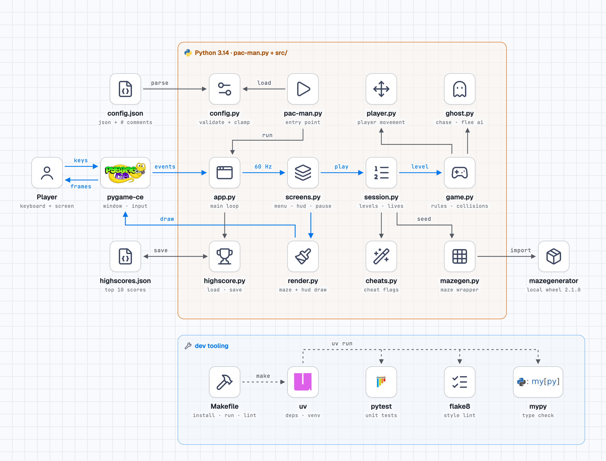

*This project has been created as part of the 42 curriculum by hkanamit, kyonaha.*

# Pac-Man

## Description

A complete, playable Pac-Man-like game written in Python with object-oriented
code and a graphics library restricted to MLX-equivalent functions
(`pygame-ce`, used only through the calls listed in
[project_management/mlx_pygame_mapping.en.md](project_management/mlx_pygame_mapping.en.md)).

The goal of the project is to build a full game loop on top of a maze
generator written by another group, and to make it robust enough that a
reviewer can edit the configuration during the defense without ever seeing a
Python traceback.

<picture>
  <source media="(prefers-color-scheme: dark)" srcset="docs/architecture-dark.png">
  
</picture>

Blue arrows: the main loop (input → update → draw). Grey arrows: calls
between modules. Dashed arrows: development tools. Details are in
[General Software Architecture](#general-software-architecture).

Features:

- Mazes generated by the assigned `mazegenerator` package (not our own).
- 4 ghosts that chase the player (shortest path) and run away when frightened.
- Pacgums in every reachable corridor, super-pacgums in the 4 corners.
- At least 10 levels, each with its own maze size and time limit; score and
  lives carry over between levels.
- Main menu, instructions, highscores, in-game HUD, pause menu, game over and
  victory screens with name entry.
- Persistent top-10 highscores stored in a JSON file.
- A JSON configuration file with `#` comments, validated with safe defaults.
- A cheat mode so reviewers can test every feature quickly.

Game loop: **Main menu → Start game → Win or lose → Enter name → Highscores →
Main menu.**

## Instructions

### Requirements

- [uv](https://docs.astral.sh/uv/) (dependency manager). Install it with:
  `curl -LsSf https://astral.sh/uv/install.sh | sh`
- Python 3.10 or newer. uv uses the version pinned in `.python-version`
  (3.14) and downloads it if it is missing.

### Install and run

```sh
make install                 # creates .venv with pygame-ce and mazegenerator
make run                     # same as: uv run python pac-man.py config.json
```

The program takes exactly one argument, the configuration file. `make install`
puts the dependencies in `.venv`, so activate it to launch the game with
`python3` directly:

```sh
source .venv/bin/activate
python3 pac-man.py config.json
```

### Other Makefile rules

| Rule | What it does |
|---|---|
| `make debug` | Runs the game under `pdb` |
| `make lint` | `flake8` and `mypy` with the flags required by the subject |
| `make lint-strict` | `flake8` and `mypy --strict` |
| `make test` | Runs the `pytest` test suite |
| `make build` | Builds the distributable package `dist/pac-man.zip` (see [Packaging](#packaging)) |
| `make clean` | Removes `__pycache__`, `.mypy_cache`, `.pytest_cache`, `build` and `dist` |

### Controls

| Key | Action |
|---|---|
| Arrow keys / WASD | Move (a key pressed early is kept until the next turn is possible) |
| ESC / P | Pause and resume |
| UP / DOWN, ENTER / SPACE | Choose and select in menus |
| ESC (main menu) | Quit |
| Letters, digits, SPACE, BACKSPACE, ENTER | Type and confirm your name after a game |
| ESC (name entry) | Skip saving and go back to the main menu |

### Cheat mode (for reviewers)

Press **C** during a game to turn cheat mode on or off. `CHEAT` appears at the
top right of the HUD, with the toggles that are on shown in yellow. Turning
cheat mode off also turns every cheat off. Cheats last across levels and are
reset when a new game starts.

| Key (also numpad) | Cheat |
|---|---|
| 1 | Invincibility on/off: touching a normal ghost costs no life (frightened ghosts can still be eaten) |
| 2 | Ghost freeze on/off: ghosts stop moving (their fright and respawn timers keep running) |
| 3 | Fast player on/off: the player moves 1.5x faster |
| 4 | +1 life (up to 9) |
| 5 | Skip the level (on the last level, this wins the game) |

### Rules

- Eat every pacgum and super-pacgum to clear a level. Clear all levels to win.
- A super-pacgum makes the ghosts frightened for 7 seconds: they turn blue,
  slow down to half speed and run away. They blink white during the last
  2 seconds.
- An eaten ghost disappears and comes back in its own corner after 3 seconds.
  If the fright is still on, it comes back frightened for the time left.
- Touching a normal ghost costs a life. Everyone freezes for 2 seconds, then
  the player goes back to the center and the ghosts to their corners. The
  pacgums already eaten stay eaten.
- **Time limit:** each level has a time limit shown as `TIME` in the HUD. The
  timer stops while the game is frozen after a lost life or paused. When it
  reaches 0, the game ends immediately (`TIME UP`), and the player can still
  enter a name for the highscores.
- The game is over when no lives are left or the time runs out.

## Configuration

The configuration file is standard JSON, plus comment lines: any line whose
first non-space character is `#` is ignored. A `#` after a value on the same
line is **not** a comment and makes the JSON invalid.

Error handling:

- **Cannot continue** (missing file, a directory, no permission, not UTF-8,
  invalid JSON, top level not an object): the game prints a one-line
  `Error: ...` message and exits. No traceback.
- **Wrong number of arguments**: the game prints
  `usage: python3 pac-man.py <config.json>` and exits.
- **Missing or invalid value**: a `WARNING: config: ...` line is printed and a
  safe value is used. A value of the wrong type (including `true` / `false`
  for a number) uses the default. An integer out of range is clamped to the
  nearest allowed value.
- **Unknown key**: a warning is printed and the key is ignored.

### Keys

All numbers are integers.

| Key | Default | Allowed range | Meaning |
|---|---|---|---|
| `lives` | 3 | 1–9 | Lives at the start of a game |
| `seed` | 42 | 0–2147483647 | Seed of the level 1 maze. Levels 2+ are always random. `0` makes level 1 random too |
| `points_per_pacgum` | 10 | 0–1000000 | Points for a pacgum |
| `points_per_super_pacgum` | 50 | 0–1000000 | Points for a super-pacgum |
| `points_per_ghost` | 200 | 0–1000000 | Points for eating a frightened ghost |
| `highscore_filename` | `"highscores.json"` | non-empty string | Highscore file. A relative path is relative to the folder the game is started from |
| `level_max_time` | 90 | 10–999 | Default time limit of a level, in seconds |
| `width` | 21 | 14–40 | Default maze width, in cells |
| `height` | 21 | 10–25 | Default maze height, in cells |
| `levels` | 10 levels of `width` x `height` | 10–50 entries | List of levels, played in order |

Each entry of `levels` is an object with `width`, `height` and optionally
`level_max_time`. A key left out of a level uses the top-level `width`,
`height` or `level_max_time`. If `levels` has fewer than 10 entries, levels of
the default size are added up to 10; entries after the 50th are ignored.
An entry that is not an object is replaced by a level of the default size.

The size limits come from the maze generator and the screen: below 14x10 the
generator does not draw its "42" pattern, and 40x25 is the largest maze whose
window (1288x836 px) still fits on a 1440x900 screen.

### Example (the provided `config.json`, shortened)

```json
# Lines starting with # are comments
{
    "lives": 3,
    "seed": 42,
    "points_per_pacgum": 10,
    "points_per_super_pacgum": 50,
    "points_per_ghost": 200,
    "highscore_filename": "highscores.json",
    "level_max_time": 90,
    "levels": [
        {"width": 15, "height": 11},
        {"width": 15, "height": 13},
        {"width": 21, "height": 17, "level_max_time": 100}
    ]
}
```

With this example, 7 more 21x21 levels would be added to reach 10.

## Highscore

- **Storage:** a JSON file, by default `highscores.json` in the folder the game
  is started from (set with `highscore_filename`):

  ```json
  {"highscores": [{"name": "ALICE", "score": 1200}, {"name": "BOB", "score": 800}]}
  ```

- **Rules:** the top 10 scores are kept, sorted from highest to lowest. On a
  tie, the score entered first stays above. A name is 1 to 10 letters, digits
  or spaces (not only spaces). A score is a non-negative integer.
- **Loading:** the file is read once when the game starts. A missing file
  means an empty list (first launch). An unreadable or broken file, or a file
  with the wrong structure, prints a warning and starts with an empty list.
  Entries with an invalid name or score are skipped with a warning; the valid
  ones are kept.
- **Saving:** after every game (win or lose) the player can type a name
  (ENTER with an empty name saves the score as `PLAYER`). When
  the score makes the top 10, the file is saved immediately and the
  highscores screen shows the new entry in yellow. The file is written to a
  temporary file first and then renamed over the old one, so a failure in the
  middle never destroys the previous highscores. If saving fails (missing
  folder that cannot be created, no permission, ...), a warning is printed,
  the screen says so, and the game keeps running.
- **Viewing:** `HIGHSCORES` in the main menu.

**Why this way:** a JSON file is human-readable, so reviewers can open it,
break it on purpose, and see that the game survives. The name entry only
accepts the characters and length that the loader accepts, and the loader
validates every entry, so a hand-edited file can never put an invalid entry
on screen. Saving right after the name is entered
(instead of only when the program exits) means a score is not lost if the
window is closed. The atomic replace protects the file from a crash or a full
disk during writing.

## Maze Generation

We use the assigned package `mazegenerator` 2.1.0 as-is, installed from the
wheel at the root of the repository (`mazegenerator-2.1.0-py3-none-any.whl`,
declared in `pyproject.toml`). Our adapter is
[src/mazegen.py](src/mazegen.py); the package itself is never modified.

```python
from mazegenerator import MazeGenerator

generator = MazeGenerator(size=(width, height), perfect=False, seed=seed)
grid = generator.maze          # grid[y][x], an int per cell
```

- **Interface:** the constructor takes `size=(width, height)` (the package's
  own README shows `width=` / `height=`, which does not work). `perfect=False`
  removes dead ends so the corridors suit Pac-Man.
- **Wall format:** walls are *between* cells. The low 4 bits of each cell are
  its walls: North = 1, East = 2, South = 4, West = 8 (bit set = wall). The
  game logic uses this format directly: moving from a cell is allowed when
  the wall bit for that direction is not set and the next cell is inside the
  maze.
- **The "42" pattern:** the generator puts isolated cells with all four walls
  (value 15) in the middle. They are drawn dark blue, contain no pacgums, and
  nobody starts on them: the start cell (center) and the four corners are
  moved to the nearest cell that is not part of the pattern.
- **Seeds:** level 1 uses `seed` from the configuration (42 by default);
  every later level uses seed `0`, which the package treats as random.
- **Randomness side effect:** the package reseeds Python's global `random`
  module, so the ghosts use their own `random.Random` instance and are not
  affected.
- **Errors:** any exception from the package, or a grid with the wrong size or
  non-integer values, is turned into a `MazeError`, and the game exits with a
  clear `Error: ...` message instead of a traceback.
- **Pacgum placement:** a breadth-first search from the start cell finds every
  reachable cell. Super-pacgums go on the 4 corners, pacgums on every other
  reachable cell except the start, so every level can always be cleared.

## Implementation

- **Fixed time step:** the main loop ([src/app.py](src/app.py)) updates the
  game in steps of 1/60 s, whatever the drawing speed. Movement speed is
  therefore the same on every machine. After a stall (a slow frame, the
  window being dragged), at most 0.25 s is caught up, so the game never jumps
  ahead.
- **Movement:** a character's position is an integer cell plus a `progress`
  (0 to 1) toward the next cell ([src/mover.py](src/mover.py)). Turns and wall
  checks happen only at cell centers, so characters never enter a wall, and
  the drawing can still be smooth. The player buffers the last key pressed
  and turns as soon as that direction is open; reversing is instant.
- **Speeds (cells per second):** player 6.0 (9.0 with the fast cheat), ghosts
  3.9, 3.6, 3.3 and 3.0, halved while frightened.
- **Ghost AI** ([src/ghost.py](src/ghost.py)): at each cell center a ghost
  computes the shortest walking distance to the player's cell (BFS) and takes
  the neighbor with the smallest distance, or the largest one when
  frightened. Ghosts turn around only in a dead end or when they become
  frightened; ties are broken at random.
- **Collisions:** the player and ghosts are squares of 0.6 cell, and
  collisions are checked after everyone has moved in a step. In one step a
  character moves at most 0.15 cell, far less than the 0.6 cell touch
  distance, so a player and a ghost crossing each other are always detected.
  Touching several ghosts in one step costs only one life.
- **Graphics restricted to MLX equivalents:** no `pygame.draw`. Every sprite is
  a solid-color image created once at start-up and copied to the window each
  frame (like `mlx_new_image` + `mlx_put_image_to_window`). Text uses one
  built-in font at fixed coordinates (like `mlx_string_put`). No sound. The
  full mapping is in
  [project_management/mlx_pygame_mapping.en.md](project_management/mlx_pygame_mapping.en.md).
- **No crash:** configuration and highscore problems become warnings;
  unrecoverable errors become one-line messages; `pac-man.py` catches any
  remaining exception as a last resort, and `pygame.quit()` always runs.
- **Code quality:** type hints on every function; docstrings on every module,
  class and function in `src/` and `pac-man.py`; `flake8` and `mypy` pass
  with the subject's flags; `pytest` tests cover
  the configuration, highscores, movement, collisions, ghosts, levels, cheats
  and screens. The game logic does not import pygame, so it is tested without
  a window.

## General Software Architecture

The overview diagram is in the [Description](#description) section.

```
pac-man.py            entry point: checks the argument, loads the config, starts App
src/
├── config.py         Config, LevelConfig, load_config()  - JSON with comments, validation
├── highscore.py      HighscoreTable, Entry               - top 10, load / save
├── app.py            App                                 - window, fixed-step main loop
├── screens.py        Screen and its subclasses           - menus, game, pause, results
├── render.py         Renderer, TextWriter                - draws the maze, sprites, HUD
├── session.py        Session                             - one game: level 1 to the end
├── game.py           Game, Rules                         - one level: score, lives, time
├── cheats.py         Cheats                              - cheat toggles
├── player.py         Player(Mover)                       - keyboard-driven character
├── ghost.py          Ghost(Mover)                        - chase / frightened / eaten
├── mover.py          Mover                               - cell-based movement
└── mazegen.py        Maze, Direction, MazeError          - adapter for mazegenerator
tests/                pytest tests, one file per area
project_management/   project management documents
```

The code is split into two layers:

- **Logic (no pygame):** `Session` → `Game` → `Player`, `Ghost` → `Mover` →
  `Maze`. `Session` creates a new `Maze` and `Game` for each level and passes
  the score, lives and the shared `Cheats` object along. `Game` handles one
  level: eating, the timer, collisions and losing lives.
- **Presentation (pygame):** `App` owns the window and the loop and delegates
  everything to the current `Screen`. Each screen has `handle_key()`,
  `update()` and `draw()`; `handle_key()` and `update()` return the next
  screen (`self` to stay, `None` to quit), so screen changes are just return
  values:

  ```
  MainMenuScreen ──▶ PlayScreen ──▶ ResultScreen ──▶ HighscoresScreen ──▶ MainMenuScreen
        │                │  ▲             │ (ESC)
        │                ▼  │             └──────────────▶ MainMenuScreen
        │            PauseScreen ──▶ MainMenuScreen
        ├──▶ HighscoresScreen
        └──▶ InstructionsScreen
  ```

  `PlayScreen` turns keys into `Session` calls and uses a `Renderer` to draw
  the session's state. The renderer only reads the state and never changes
  it. A `Context` (config, `TextWriter`, `HighscoreTable`) is shared by all
  screens.

## Project Management

All project management documents are in
[project_management/](project_management/):

- [project_overview.md](project_management/project_overview.md): requirements
  checklist, analysis of the assigned maze package, effort estimates, roles,
  planned architecture, schedule and risk analysis.
- [mlx_pygame_mapping.en.md](project_management/mlx_pygame_mapping.en.md):
  every pygame feature we use and its MLX equivalent, with the open questions.
- [reviews/review_lessons.md](project_management/reviews/review_lessons.md):
  lessons from past peer reviews of this project, turned into a checklist.
- [progress.md](project_management/progress.md): planned schedule compared
  week by week with what was actually done, from the git history.
- [acceptance_tests.md](project_management/acceptance_tests.md): acceptance
  test plan for every mandatory requirement, with the results.
- [issues_log.md](project_management/issues_log.md): problems met during the
  project and how we solved them.

The documents in `project_management/` are written in Japanese, except
`mlx_pygame_mapping.en.md`, which also exists in English.

How we worked: `project_overview.md` planned a split between game logic
(maze adapter, movement, ghosts, levels, cheats) and the outer layer
(configuration, highscores, rendering, screens, packaging), with the
interface between them agreed first. Features were developed on feature
branches and merged into `main` through GitHub pull requests (PRs #1 to #11).
The README, the docstrings, the architecture diagram and the ghost speed
tuning were committed directly to `main`.

| Member | Pull requests |
|---|---|
| hkanamit | Ghost chase, `Mover` and collisions (#1, #3); frightened and eaten ghosts, maze size in the config (#5); screens and start page (#7); cheat mode (#8) |
| kyonaha | Makefile and `pac-man.py` entry point (#2); pacgums, time limit and HUD (#4); level progression and level config (#6); highscores and name entry (#9); packaging with `make build` (#10); default name for an empty highscore entry (#11) |

**Reviews and decisions.** Each pull request was reviewed and merged by the
other member, so that both of us know the whole code base. Rules that the
subject leaves open were decided together and written down where they are
used: the pygame features allowed as MLX equivalents in
`mlx_pygame_mapping.en.md`, and the gameplay rules (time limit, respawn,
speeds) in this README.

**Progress compared with the schedule.** The plan was four weeks from
2026-11-03. The game was ahead of schedule: levels and the cheat mode, planned
for week 3, were done in week 2, and the game was feature complete in week 3.
The exception was packaging: the PyInstaller and itch.io test planned for
week 1 was skipped, and `make build` was only written at the end of week 3.
Details are in [progress.md](project_management/progress.md).

**Acceptance tests.** `make lint` (flake8 and mypy) reports no errors and the
185 pytest tests pass. The game was also started with missing, broken and
invalid configuration files: it never shows a traceback. The checks done by
playing the game are listed in
[acceptance_tests.md](project_management/acceptance_tests.md).

**Problems met.**

- *Which pygame features count as MLX equivalents.* The subject does not say
  how far pygame's font functions can go. We decided that all text goes
  through one function that uses a single built-in font and size, ASCII only,
  with no background and no centering.
- *Ghost difficulty.* The ghosts first moved at 5.4 to 4.5 cells per second,
  close to the player's 6.0, and with BFS chasing they were too strong. We
  slowed them down to 3.9 to 3.0 cells per second. An eaten ghost that comes
  back while the fright is still on now comes back frightened for the time
  left.

Details are in [issues_log.md](project_management/issues_log.md).

## Packaging

The game is packaged with [PyInstaller](https://pyinstaller.org/) as a single
executable. The packaging spec is [pac-man.spec](pac-man.spec), at the root of
the repository. To regenerate the package:

```sh
make build                   # creates dist/pac-man.zip
```

`make build` runs `pyinstaller pac-man.spec` (PyInstaller is fetched by uv for
this command only), then zips three files:

| File | Content |
|---|---|
| `pac-man` | The executable: `pac-man.py`, `src/`, pygame-ce and the maze package |
| `config.json` | The default configuration, which the player can edit |
| `README.txt` | In-package instructions (controls, cheats, configuration), copied from [PACKAGE_README.txt](PACKAGE_README.txt) |

To play, unzip the package, open a terminal in the folder and run
`./pac-man config.json`. The highscores are saved in that folder.

PyInstaller does not cross-compile: the package only works on the operating
system and CPU it was built on, so `make build` must be run on each target
platform.

The Linux build is published on itch.io as an unlisted draft (free, not
listed on the site): <https://hkanamit.itch.io/simple-pacman?secret=Zl2HgCp7ys7wQiuuS1DRs3Z7gI>.
Download `pac-man.zip` from that page, unzip it and run `./pac-man config.json`.

## Resources

- [pygame-ce documentation](https://pyga.me/docs/)
- [MinilibX Python documentation](https://sarafreitas-dev.github.io/MinilibX-42-Pyhton-Documentation/)
  (unofficial guide used to decide which pygame functions have an MLX equivalent)
- [The Pac-Man Dossier](https://pacman.holenet.info/) by Jamey Pittman: how the
  original ghosts move and behave
- [Fix Your Timestep!](https://gafferongames.com/post/fix_your_timestep/) by
  Glenn Fiedler: fixed time step game loops
- [Python `json` module](https://docs.python.org/3/library/json.html) and
  [`logging` module](https://docs.python.org/3/library/logging.html)
- [PEP 257 – Docstring Conventions](https://peps.python.org/pep-0257/)
- [uv documentation](https://docs.astral.sh/uv/)

### Use of AI

- Claude (Anthropic) was used to draft this README and to write the docstrings
  in `src/` and `pac-man.py` from the existing code comments. Both are to be
  reviewed by the team.
- Claude was also used for the following tasks:
  - *Reading the subject and planning:* summarizing the requirements and
    drafting `project_management/project_overview.md` (roles, schedule, risk
    analysis).
